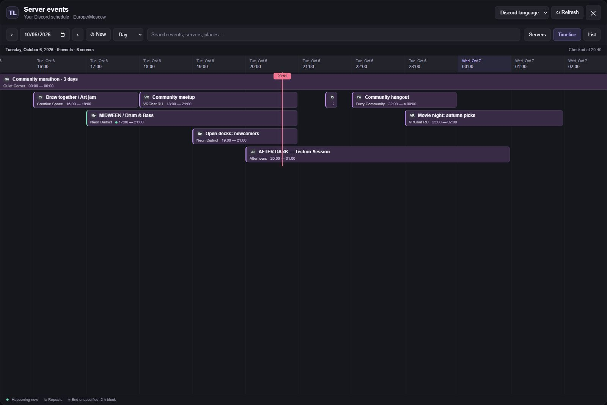

# Server Events Timeline

[](https://github.com/N1ades/vencord-server-events-timeline/actions/workflows/ci.yml)
[](LICENSE)

A Vencord user plugin that brings **scheduled events from all your Discord servers into one compact timeline**. Inspired by [vrc.tl](https://vrc.tl/), with time across the horizontal axis and overlapping events arranged in shared lanes.



*The screenshot uses synthetic events. Server icons, event names, and descriptions come from Discord in the installed plugin.*

## Features

- **One schedule for every server.** Collect upcoming and ongoing scheduled events from the servers you have joined.
- **Compact lanes.** Events from different servers share a row when they do not overlap. Each block shows its server icon and name; there is no separate server column.
- **Infinite horizontal scrolling.** Move through past and future dates, including empty days, without growing the rendered range indefinitely.
- **Drag to scroll.** Hold the left mouse button on the timeline or an event block and move the schedule. Releasing after a drag does not open the event.
- **Sticky event labels.** Titles and server details stay at the visible left edge until the event ends.
- **Local dates and weekdays.** Weekend highlights, a current-time line, and a **Now** button that works from any date or the list view.
- **Search and filters.** Find events by name, description, location, or server. Filter servers, show active events only, and adjust the timeline zoom.
- **Recurring events.** Discord's recurrence rules, canceled occurrences, rescheduled occurrences, and events that cross midnight.
- **Native event details.** Read the description and open Discord's event dialog, including a specific recurring occurrence.
- **Open the server.** Click its name in the event details panel to close the timeline and switch to that server in Discord.
- **Five interface languages.** English, Russian, Japanese, Spanish, and Korean. The default follows Discord's language; unsupported languages fall back to English. Manual overrides are saved.
- **Automatic refresh.** Updates from Discord's stores and a server refresh every five minutes while the window is open. Preferences persist between sessions.

## Install

This is a **custom user plugin**, not part of the official Vencord distribution. You need a Vencord source checkout and a custom build. Start with the [official custom-plugin installation guide](https://docs.vencord.dev/installing/custom-plugins/).

With Vencord's dependencies already installed, run these commands **from the Vencord repository root**:

```sh
git clone https://github.com/N1ades/vencord-server-events-timeline.git src/userplugins/serverEventsTimeline
node scripts/build/build.mjs --disable-updater
node scripts/runInstaller.mjs -- --install
```

Choose your Discord installation in the installer, fully quit Discord from the system tray, and reopen it. Enable **ServerEventsTimeline** under **Settings → Vencord → Plugins**.

Keep `index.tsx` directly at `src/userplugins/serverEventsTimeline/index.tsx`; adding another directory level will prevent Vencord from discovering the plugin. A regular Vencord installer cannot import this repository as a drop-in plugin file.

### Windows helper

If you downloaded this repository separately, the included helper copies the plugin to your existing Vencord checkout, backs up an earlier copy, and builds it:

```powershell
.\Install.ps1 -VencordPath "C:\path\to\Vencord" -Inject
```

The helper requires Node.js 22 or newer. Omit `-Inject` to build without launching the installer.

### Other clients

For browser builds, run `node scripts/build/buildWeb.mjs` from Vencord's root. For Vesktop, select the custom build's `dist` folder in its developer settings. Follow the installation instructions for your client.

## Use

Open the calendar button above the server list, run the local `/events-timeline` command, or use the button in the plugin settings.

| Control | What it does |
| --- | --- |
| Date picker and arrows | Jump to a date or move by the selected day / three-day / weekly step |
| **Now** | Return to the current time and switch back to the timeline |
| **Servers** | Reveal server filters, active-only filtering, and zoom |
| **Timeline / List** | Switch between the horizontal schedule and an agenda |
| Language selector | Follow Discord or choose a saved language override |
| Event block | Open the details panel; its button opens Discord's native event dialog |
| Server name in the details panel | Close the timeline and switch to that server |
| Drag the timeline with the left mouse button | Move the schedule horizontally or vertically |
| **Refresh** | Check events across the joined servers again |

When an organizer does not provide an end time, the event displays **≈**. Choose an estimated block duration of one, two, or four hours in the plugin settings. This estimate does not indicate when the event actually finishes.

## Event data and limitations

The plugin reads **Discord's scheduled events**, the ones shown in a server's **Events** section. It does not scan announcement messages or read direct messages. Events in channels are included only when the current account can view that channel.

Completed and canceled events are excluded. Scrolling into the past does not recover deleted events or create an archive. Event titles and descriptions stay in the organizer's original language.

Fetching uses Discord's native event actions, a sequential queue, and a five-minute cache. Individual server failures are reported while the remaining servers continue loading. Disabling the plugin or switching accounts cancels further requests. There is no external event service or telemetry.

The plugin relies on internal Discord modules. A Discord update can change these interfaces and require a plugin update. The standalone preview validates the UI with synthetic data, not a live Discord session.

## Update

From the plugin directory, pull the latest version:

```sh
git pull --ff-only
```

Rebuild Vencord from its repository root and fully restart Discord. The PowerShell helper is also suitable for updating an extracted copy.

## Development

Standalone tests and a browser preview run without Discord:

```sh
npm ci
npm test
npm run preview
```

Open http://127.0.0.1:8767. The preview uses the real timeline component with synthetic server and event data. `npm run preview:build` builds it without starting a server.

CI runs the standalone tests and preview build. For type checking, Vencord linting, and native integration checks, see [CONTRIBUTING.md](CONTRIBUTING.md). Release notes are in [CHANGELOG.md](CHANGELOG.md).

## Credits and license

Built for [Vencord](https://github.com/Vendicated/Vencord), with a timeline layout inspired by [vrc.tl](https://vrc.tl/). This project is independent of Vencord, Discord, and vrc.tl.

Licensed under [GPL-3.0-or-later](LICENSE). Existing Vencord copyright notices are preserved.
